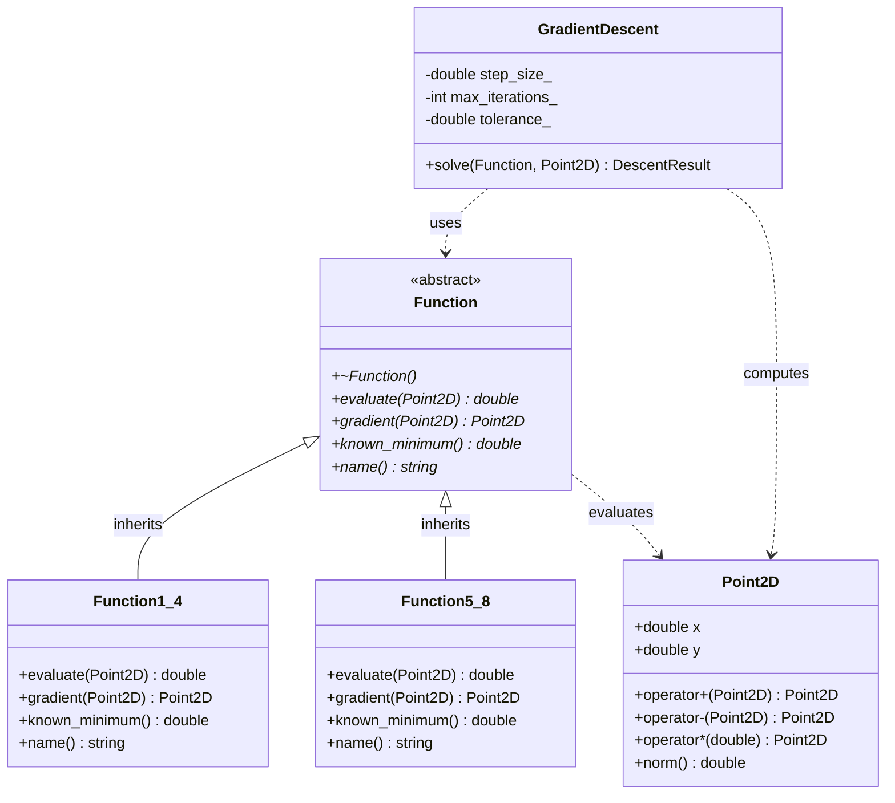

# 📉 SpadellataAllaNorma — Gradient Descent in C++


Implementazione in C++ dell'algoritmo di **discesa del gradiente (Gradient Descent) a passo costante** per la ricerca del minimo locale di funzioni scalari bidimensionali $f: \mathbb{R}^2 \to \mathbb{R}$, sviluppata come prova intermedia per il corso di *Laboratorio di Programmazione*.

---

## 🧮 Modello Matematico

Dato un punto di partenza $p_0 = (x_0, y_0)$ e un passo costante $a > 0$, l'algoritmo genera una successione di punti $\{p_k\}$ lungo la direzione di massima decrescita del gradiente:

$$p_{k+1} = p_k - a \nabla f(p_k)$$

dove il gradiente è definito come $\nabla f(p_k) = \left( \frac{\partial f}{\partial x}(p_k), \, \frac{\partial f}{\partial y}(p_k) \right)$.

### Criteri di Arresto
L'esecuzione termina al verificarsi di almeno una delle seguenti condizioni:
1. **Raggiungimento del tetto massimo di iterazioni:** $k \ge N$
2. **Convergenza sotto soglia di tolleranza:** $||\nabla f(p_k)|| = \sqrt{\left(\frac{\partial f}{\partial x}(p_k)\right)^2 + \left(\frac{\partial f}{\partial y}(p_k)\right)^2} < T$

Ad ogni iterazione $k$ viene inoltre monitorato l'errore rispetto al minimo analitico noto $m$:

$$e_k = f(p_k) - m$$

---

## 🏗️ Architettura Software (OOP)

Il progetto sfrutta il **polimorfismo dinamico** tramite una classe base astratta (`Function`) che disaccoppia completamente il motore numerico (`GradientDescent`) dalle singole equazioni matematiche.



### Struttura della Repository

```text
SpadellataAllaNorma/
├── assets/
│   ├── favicon.ico          # Icona del progetto (per la documentazione html)
│   ├── logo.png             # Logo del progetto (per la documentazione html) 
├── docs/
│   ├── ...                  # File html/js generati da doxygen per la documentazione
├── include/
│   ├── Point2D.h            # Struttura vettoriale 2D e algebra di base
│   ├── Function.h           # Interfaccia astratta per le funzioni R^2 -> R
│   ├── GradientDescent.h    # Motore iterativo e struct dei risultati
│   ├── funzioni_1_4.h       # Dichiarazioni funzioni f1 - f4
│   └── funzioni_5_8.h       # Dichiarazioni funzioni f5 - f8
├── src/
│   ├── Point2D.cpp          # Implementazione operatori vettoriali e norma
│   ├── GradientDescent.cpp  # Logica del ciclo, criteri di stop e logging
│   ├── funzioni_1_4.cpp     # Implementazione f1 - f4 e rispettivi gradienti
│   ├── funzioni_5_8.cpp     # Implementazione f5 - f8 e rispettivi gradienti
│   └── main.cpp             # Suite automatizzata di test obbligatori ed esplorativi
├── README.md                # Documentazione principale repository GitHub
├── consegna.pdf             # Consegna del progetto assegnata dal docente
```

---

## 📊 Funzioni di Benchmark e Parametri di Test

| ID | Espressione Analitica $f(x, y)$ | Passo ($a$) | Dominio Standard |
| :---: | :--- | :---: | :---: |
| **$f_1$** | $\frac{x^2 + y^2}{2}$ | $\frac{1}{5}$ | $[-4, 4]^2$ |
| **$f_2$** | $\frac{x^2 + 16y^2}{2}$ | $\frac{2}{25}$ | $[-4, 4]^2$ |
| **$f_3$** | $(x^2 - 1)^2 + y^2$ | $\frac{1}{20}$ | $[-1.5, 1.5]^2$ |
| **$f_4$** | $(x^2 - 1)^2 + \frac{(x - 1)^2}{5} + y^2$ | $\frac{1}{20}$ | $[-1.5, 1.5]^2$ |
| **$f_5$** | $4\sinh^2\left(\frac{x}{2}\right) + y^2$ | $\frac{3}{20}$ | $[-2, 2]^2$ |
| **$f_6$** | $\ln(1 + x^2 + y^2)$ | $\frac{3}{10}$ | $[-4, 4]^2$ |
| **$f_7$** | $1 - e^{-(x^2 + y^2)}$ | $\frac{1}{5}$ | $[-1.5, 1.5]^2$ |
| **$f_8$** | $2 - \cos(\pi x) - \cos(\pi y)$ | $\frac{1}{10}$ | $[-4, 4]^2$ |

---

## ⚙️ Compilazione ed Esecuzione

Il codice è scritto secondo lo standard C++ ed è verificato per compilare senza warning su ambiente **VLab / Taliercio.2020**.

### Compilazione da terminale
Dalla cartella principale del progetto:

```bash
g++ -std=c++17 -Wall -Wextra -Iinclude src/*.cpp -o gradient_descent
```

### Esecuzione
* **Linux / macOS / VLab:**
  ```bash
  ./gradient_descent
  ```
* **Windows (PowerShell / CMD):**
  ```powershell
  .\gradient_descent.exe
  ```

---

## 👥 Team e Suddivisione dei Compiti

| Membro | Branch | Responsabilità Principali |
| :--- | :--- | :--- |
| **Francesco** | `Francesco` | Setup repository & CI/Git workflow, progettazione architettura OOP (`Point2D`, `Function`), implementazione motore `GradientDescent`, orchestrazione suite di test in `main.cpp` e validazione finale su VLab. |
| **Lorenzo** | `Lorenzo` | Calcolo analitico derivate parziali e minimi noti per $f_1 \dots f_4$, implementazione moduli `funzioni_1_4.h/.cpp` e definizione casi di test dedicati. |
| **Denis** | `Denis` | Calcolo analitico derivate parziali e minimi noti per $f_5 \dots f_8$, implementazione moduli `funzioni_5_8.h/.cpp`, casi di test e redazione reportistica `README.md`. |

---

## 📝 Note Tecniche e Problemi Riscontrati
* *(Spazio riservato alle note tecniche per la valutazione: es. comportamento su punti di sella o minimi locali multipli per $f_3, f_4, f_8$, gestione dell'arresto su passi $a$ elevati, ecc.)*