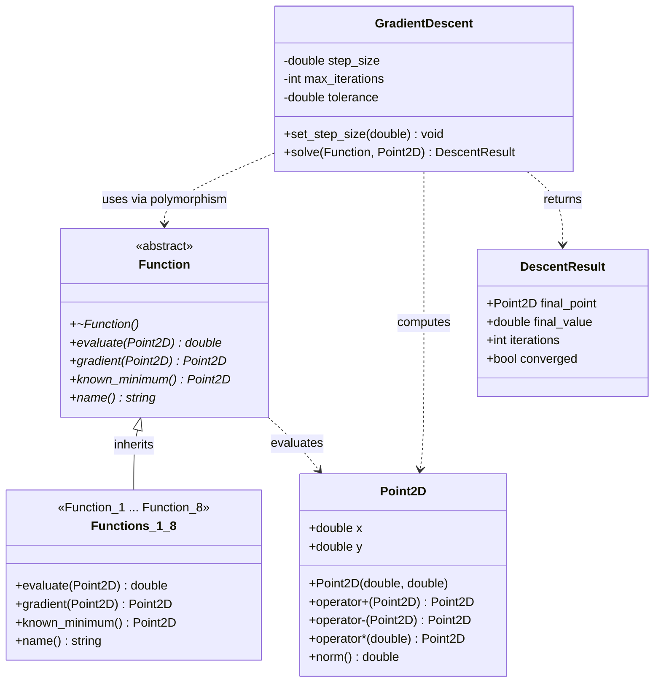

# 📉 SpadellataAllaNorma — Gradient Descent in C++


[](https://FrancescoDuluta.github.io/SpadellataAllaNorma/)


Implementazione modulare in C++ dell'algoritmo di **discesa del gradiente (Gradient Descent) a passo costante** per la ricerca del minimo locale di funzioni scalari bidimensionali $f: \mathbb{R}^2 \to \mathbb{R}$, sviluppata come prova intermedia per il corso di *Laboratorio di Programmazione* (Università degli Studi di Padova).

> **Nota per il Docente:** Oltre a soddisfare integralmente tutti i requisiti funzionali, numerici e strutturali della consegna (separazione `.h`/`.cpp`, compilazione standard `g++` senza librerie esterne su ambiente VLab/Taliercio.2020, presenza del file `README.txt` dedicato alla consegna Moodle), il gruppo ha scelto di arricchire la repository con architettura ad oggetti polimorfica, documentazione tecnica generata tramite Doxygen con formule LaTeX e automazione CI/CD su GitHub Pages. Tutti i file extra (`.github/`, `assets/`, `Doxyfile`, `README.md`) sono metadati di documentazione e non interferiscono in alcun modo con la compilazione del codice sorgente C++.

---

## 🎯 Motivazione Progettuale: Perché Siamo Andati Oltre la Consegna

La consegna lasciava ampia libertà progettuale sulle scelte architetturali. Il nostro gruppo ha deciso di alzare volontariamente l'asticella tecnica non per semplice esercizio di stile, ma con un obiettivo formativo preciso: **utilizzare questa prova intermedia come palestra strutturata in vista del progetto finale in C++ del corso**.

In particolare, abbiamo voluto sperimentare e padroneggiare fin da ora strumenti e flussi di lavoro adottati nello sviluppo software moderno:
1. **Sviluppo collaborativo su Git:** lavoro parallelo su branch personali, code review e integrazione dei moduli tramite Pull Request.
2. **Progettazione Object-Oriented estendibile:** disaccoppiamento tra algoritmo numerico e dominio matematico tramite classi astratte e polimorfismo dinamico.
3. **Documentazione industriale con Doxygen e LaTeX:** scrittura di docblock formali nei sorgenti per generare automaticamente un portale web navigabile, utile sia al team durante lo sviluppo sia alla comunità GitHub.
4. **Automazione CI/CD con GitHub Actions:** build e pubblicazione automatica della documentazione HTML su GitHub Pages ad ogni aggiornamento del branch `main`.

---

## 🧮 Modello Matematico

Dato un punto iniziale $p_0 = (x_0, y_0) \in \mathbb{R}^2$ e un passo costante $a > 0$, l'algoritmo genera iterativamente una successione di punti $\{p_k\}$ muovendosi nella direzione opposta al vettore gradiente (direzione di massima decrescita):

$$p_{k+1} = p_k - a \nabla f(p_k)$$

dove il gradiente è definito dal vettore delle derivate parziali prime:

$$\nabla f(p_k) = \left( \frac{\partial f}{\partial x}(p_k), \, \frac{\partial f}{\partial y}(p_k) \right)$$

### Criteri di Arresto e Monitoraggio dell'Errore
L'esecuzione si interrompe al verificarsi di almeno una delle seguenti condizioni:
1. **Limite massimo di iterazioni:** $k \ge N$
2. **Convergenza sotto soglia di tolleranza:** $||\nabla f(p_k)|| = \sqrt{\left(\frac{\partial f}{\partial x}(p_k)\right)^2 + \left(\frac{\partial f}{\partial y}(p_k)\right)^2} < T$

Ad ogni iterazione $k$ viene calcolato lo scarto rispetto al minimo analitico noto $m = f(x_{\min}, y_{\min})$:

$$e_k = f(p_k) - m$$

Lo stato corrente ($k$, $p_k$, $f(p_k)$, $e_k$, $||\nabla f(p_k)||$) viene stampato a schermo ogni 10 iterazioni ($k = 0, 10, 20, \dots$) e, senza duplicazioni, all'iterazione finale di arresto.

---

## 🏗️ Architettura Software e Scelte Implementative

Il software è progettato secondo i principi di modularità e separazione delle responsabilità, con identificatori in inglese e documentazione estesa in italiano.



### Perché queste scelte tecniche?

* **1. Classe base astratta `Function` e polimorfismo dinamico (`include/Function.h`):**
  Anziché gestire le 8 funzioni tramite blocchi condizionali (`if`/`switch`) sparsi nel codice, abbiamo definito un'interfaccia pura (`evaluate`, `gradient`, `known_minimum`, `name` con distruttore virtuale). La classe `GradientDescent` riceve un semplice riferimento `const Function&`: in questo modo il motore numerico è completamente agnostico rispetto all'equazione minimizzata e consente di aggiungere nuove funzioni di test senza modificare una sola riga dell'algoritmo.
* **2. Approccio iterativo con ciclo `while (true)` controllato (`src/gradientDescent.cpp`):**
  Abbiamo scartato la ricorsione per evitare rischi di *stack overflow* nei test con un numero elevato di iterazioni ($N \ge 10^4$). All'interno di `solve()`, abbiamo preferito un ciclo `while (true)` con uscite controllate (`break`) rispetto a un `while (k < N && norm >= T)`: questa struttura permette di calcolare **una sola volta** per iterazione gradiente, norma, valore della funzione ed errore $e_k$ prima di valutare i criteri di arresto, evitando di duplicare i calcoli prima dell'ingresso nel ciclo e al termine di ogni passo.
* **3. Robustezza numerica e gestione stampe:**
  * **Protezione da divergenza (`std::isnan` / `std::isinf`):** nei test esplorativi con passi $a$ molto grandi, le coordinate possono divergere verso infinito; il controllo immediato tramite `<cmath>` interrompe il ciclo in modo pulito segnalando la divergenza.
  * **Evitare stampe duplicate (`last_printed`):** tracciando l'indice dell'ultima iterazione stampata, il programma garantisce la stampa sia a $k=0$ (anche se si parte già sul minimo) sia sull'iterazione finale, evitando di stampare due volte l'ultima riga quando l'arresto avviene esattamente su un multiplo di 10.
* **4. Algebra vettoriale con `struct Point2D` e `DescentResult` (`include/Point2D.h`):**
  Modellare i punti e i gradienti come `struct Point2D` con overload degli operatori (`+`, `-`, `*` commutativo per scalare, `<<` per output su stream) e metodo `norm()` basato su `std::hypot` consente di tradurre la formula matematica $p_{k+1} = p_k - a\nabla f(p_k)$ nell'espressione C++ pressoché identica: `current_point = current_point - step_size * gradient;`. Gli esiti della run vengono infine impacchettati nella `struct DescentResult`.
* **5. Menu interattivo da terminale (`src/main.cpp`):**
  Il `main` implementa un ciclo `do-while` con validazione dello stream `std::cin` (`cin.fail()`, `cin.clear()`, `cin.ignore`) che consente di testare rapidamente tutte le 8 funzioni, modificare a runtime il passo $a$ e il punto di partenza $p_0$, e verificare sia i punti interni ai domini standard sia quelli esterni.

---

## 📚 Documentazione Doxygen, LaTeX e Cartella `assets/`

* **Perché Doxygen + LaTeX:** Trattandosi di un software di calcolo numerico, descrivere derivate parziali, norme euclidee e criteri di arresto in semplice testo ASCII risultava poco leggibile. Abbiamo adottato Doxygen con blocchi matematici LaTeX (`\f$ ... \f$`) direttamente negli header e nei sorgenti, allineando il codice agli standard industriali di documentazione C++.
* **Perché esiste la cartella `assets/`:** La directory `assets/` contiene esclusivamente `logo.png` e `favicon.ico`, collegati nel `Doxyfile` (`PROJECT_LOGO` e `HTML_EXTRA_FILES`) per personalizzare l'identità visiva e l'icona del sito HTML generato da Doxygen. Non viene toccata dal compilatore C++.
* **Deploy automatico su GitHub Pages:** Tramite il workflow `.github/workflows/doxygen.yml`, ad ogni push su `main` GitHub installa `doxygen` e `graphviz`, compila la documentazione HTML in memoria e la pubblica automaticamente online senza appesantire la repository con centinaia di file HTML/JS generati (opportunamente esclusi tramite `.gitignore`).

---

## 📁 Struttura della Repository

```text
SpadellataAllaNorma/
├── .github/
│   └── workflows/
│       └── doxygen.yml        # Workflow GitHub Actions per build e deploy Doxygen su Pages
├── assets/
│   ├── favicon.ico            # Favicon del portale di documentazione HTML
│   └── logo.png               # Logo del progetto nell'header della documentazione Doxygen
├── include/
│   ├── Function.h             # Interfaccia astratta (classe base pura) per funzioni R^2 -> R
│   ├── Functions_1_8.h        # Dichiarazioni delle 8 funzioni di benchmark (Function_1 ... Function_8)
│   ├── gradientDescent.h      # Dichiarazione classe GradientDescent, DescentResult e print_status
│   └── Point2D.h              # Struttura vettoriale 2D, operatori algebrici e norma euclidea
├── src/
│   ├── Functions_1_8.cpp      # Implementazione formule analitiche, gradienti e minimi noti (f1 - f8)
│   ├── gradientDescent.cpp    # Implementazione motore iterativo, criteri di arresto e logging
│   ├── main.cpp               # Interfaccia interattiva da terminale e runner dei test
│   └── Point2D.cpp            # Implementazione costruttori, operatori e funzioni friend di Point2D
├── .gitignore                 # Esclusione eseguibili (.exe), file oggetto e build locale docs/html
├── Doxyfile                   # File di configurazione Doxygen (supporto LaTeX, Graphviz e assets)
├── README.md                  # Documentazione architetturale e relazione per GitHub
└── README.txt                 # Note tecniche essenziali richieste dalla consegna per Moodle
```

---

## 📊 Funzioni di Benchmark e Parametri di Test

| ID | Espressione Analitica $f(x, y)$ | Gradiente $\nabla f(x, y)$ | Passo ($a$) | Dominio Standard | Minimo Noto ($m$) |
| :---: | :--- | :--- | :---: | :---: | :---: |
| **$f_1$** | $\frac{x^2 + y^2}{2}$ | $(x, \, y)$ | $\frac{1}{5}$ | $[-4, 4]^2$ | $0$ in $(0, 0)$ |
| **$f_2$** | $\frac{x^2 + 16y^2}{2}$ | $(x, \, 16y)$ | $\frac{2}{25}$ | $[-4, 4]^2$ | $0$ in $(0, 0)$ |
| **$f_3$** | $(x^2 - 1)^2 + y^2$ | $(4x(x^2 - 1), \, 2y)$ | $\frac{1}{20}$ | $[-1.5, 1.5]^2$ | $0$ in $(\pm 1, 0)$ |
| **$f_4$** | $(x^2 - 1)^2 + \frac{(x - 1)^2}{5} + y^2$ | $(4x(x^2 - 1) + \frac{2}{5}(x - 1), \, 2y)$ | $\frac{1}{20}$ | $[-1.5, 1.5]^2$ | $0$ in $(1, 0)$ |
| **$f_5$** | $4\sinh^2\left(\frac{x}{2}\right) + y^2$ | $(4\sinh(\frac{x}{2})\cosh(\frac{x}{2}), \, 2y)$ | $\frac{3}{20}$ | $[-2, 2]^2$ | $0$ in $(0, 0)$ |
| **$f_6$** | $\ln(1 + x^2 + y^2)$ | $\left(\frac{2x}{1+x^2+y^2}, \, \frac{2y}{1+x^2+y^2}\right)$ | $\frac{3}{10}$ | $[-4, 4]^2$ | $0$ in $(0, 0)$ |
| **$f_7$** | $1 - e^{-(x^2 + y^2)}$ | $\left(2xe^{-(x^2+y^2)}, \, 2ye^{-(x^2+y^2)}\right)$ | $\frac{1}{5}$ | $[-1.5, 1.5]^2$ | $0$ in $(0, 0)$ |
| **$f_8$** | $2 - \cos(\pi x) - \cos(\pi y)$ | $(\pi\sin(\pi x), \, \pi\sin(\pi y))$ | $\frac{1}{10}$ | $[-4, 4]^2$ | $0$ in $(2h, 2k)$ |

---

## ⚙️ Compilazione ed Esecuzione

Il progetto utilizza esclusivamente librerie standard C++ (`<iostream>`, `<cmath>`, `<string>`, `<iomanip>`, `<limits>`) ed è verificato per compilare senza warning su ambiente **VLab / Taliercio.2020**.

### Compilazione da terminale
Dalla cartella radice `SpadellataAllaNorma/`:

```bash
g++ -std=c++17 -Wall -Wextra -Iinclude src/*.cpp -o gradient_descent
```

### Esecuzione
* **Linux / macOS / VLab:**
  ```bash
  ./gradient_descent
  ```
* **Windows (PowerShell / CMD):**
  ```powershell
  .\gradient_descent.exe
  ```

---

## 👥 Team e Suddivisione dei Lavori

Il progetto è frutto di una collaborazione suddivisa su branch dedicati, sfruttando l'interfaccia astratta `Function` per sviluppare e verificare i moduli in parallelo prima dell'integrazione finale:

| Membro | Branch | Contributo e Attività Svolte |
| :--- | :--- | :--- |
| **Francesco** | `Francesco` | Setup della repository Git e pipeline CI/CD (`.github/workflows/doxygen.yml`), progettazione dell'architettura OOP (`Point2D`, `Function`), implementazione del motore numerico `GradientDescent` (`gradientDescent.h/.cpp`), sviluppo del menu interattivo di test in `main.cpp`, accorpamento finale in `Functions_1_8`, configurazione Doxygen e verifica compilazione su VLab. |
| **Lorenzo** | `Lorenzo` | Studio analitico delle derivate parziali e dei punti stazionari per le funzioni $f_1 \dots f_4$, implementazione iniziale dei rispettivi metodi (`evaluate`, `gradient`, `known_minimum`, `name`) su branch dedicato e test di convergenza su punti interni ed esterni ai domini. |
| **Denis** | `Denis` | Studio analitico delle derivate parziali e dei punti stazionari per le funzioni $f_5 \dots f_8$, implementazione iniziale dei rispettivi metodi (`evaluate`, `gradient`, `known_minimum`, `name`) su branch dedicato, esecuzione dei test sui passi di prova e redazione della reportistica (`README.txt` / `README.md`). |

---

## 🔍 Osservazioni Numeriche Rilevate nei Test

* **Punti di sella e minimi multipli ($f_3, f_4, f_8$):**
  * Su $f_3$, partendo esattamente sull'asse $x = 0$ (es. $p_0 = (0, 2)$), la componente $\frac{\partial f_3}{\partial x}$ è nulla e l'algoritmo converge al punto di sella $(0, 0)$ anziché ai minimi globali $(\pm 1, 0)$.
  * Su $f_4$, partendo con ascissa negativa sufficientemente lontana dall'origine, l'algoritmo converge al minimo locale non assoluto in $\approx (-0.8873, 0)$ anziché al minimo globale $(1, 0)$.
  * Su $f_8$, trattandosi di una superficie periodica, punti iniziali distanti dall'origine convergono al minimo locale del bacino di attrazione più vicino $(2h, 2k)$ con $h, k \in \mathbb{Z}$.
* **Sensibilità al passo $a$ ($f_2, f_7$):**
  * Su $f_2$ (valle stretta lungo $y$ per via del coefficiente $16y^2$), passi $a \ge \frac{1}{8}$ causano oscillazioni divergenti lungo l'asse delle ordinate.
  * Su $f_7$, lontano dall'origine la superficie diventa quasi piatta ($\nabla f_7 \approx 0$): per punti iniziali molto distanti il gradiente può risultare subito inferiore alla soglia $T$, arrestando l'algoritmo sul plateau.